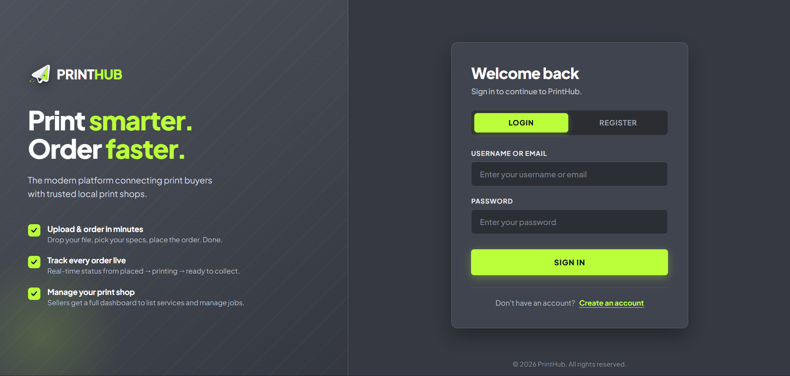
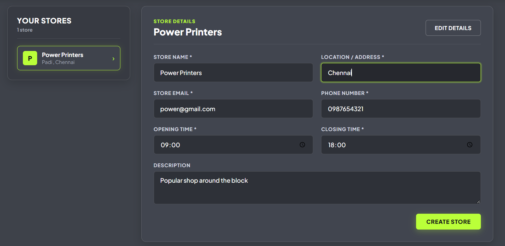
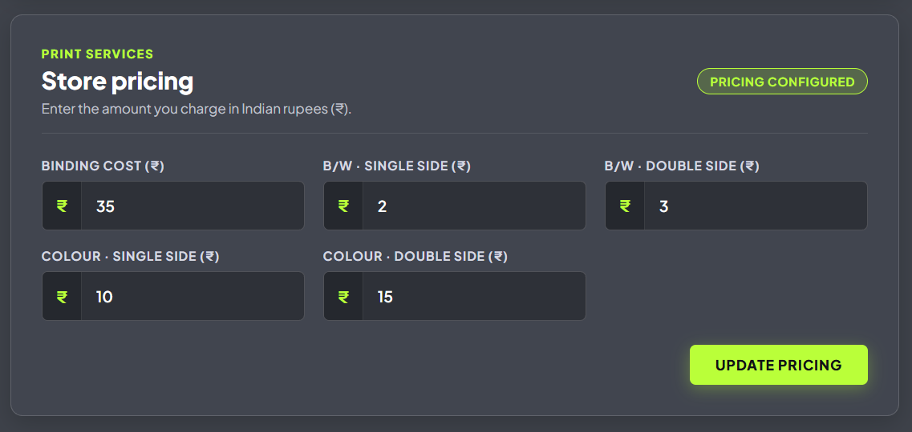
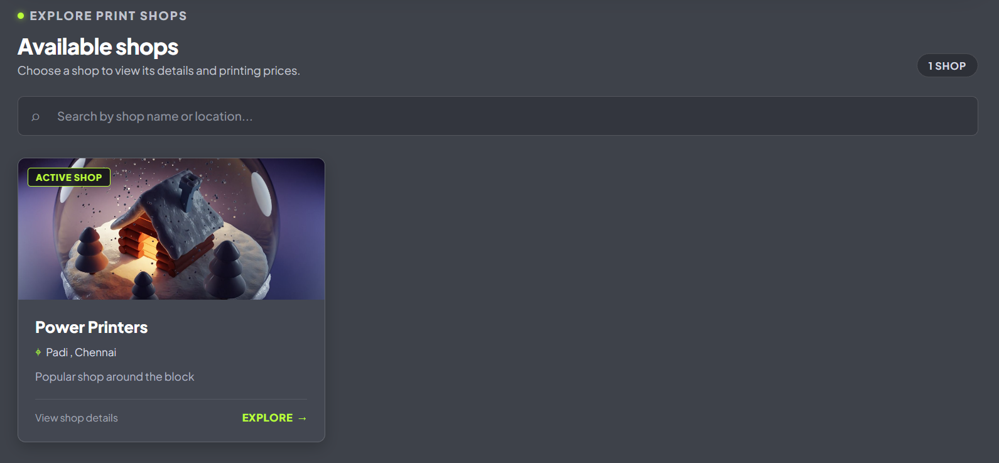
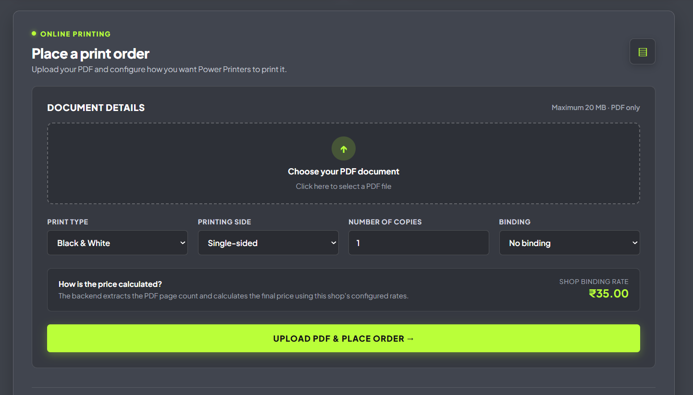
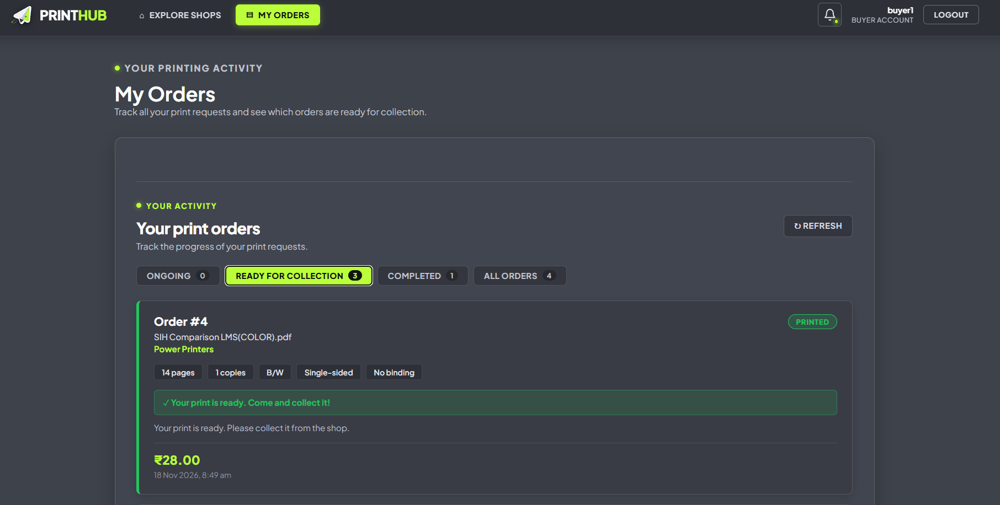
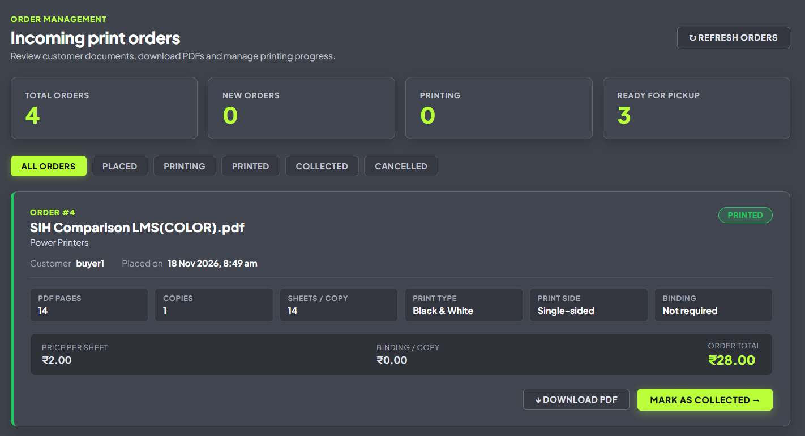
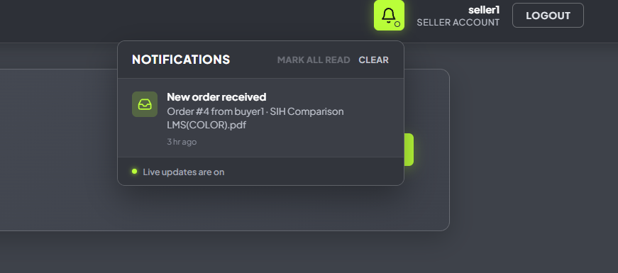
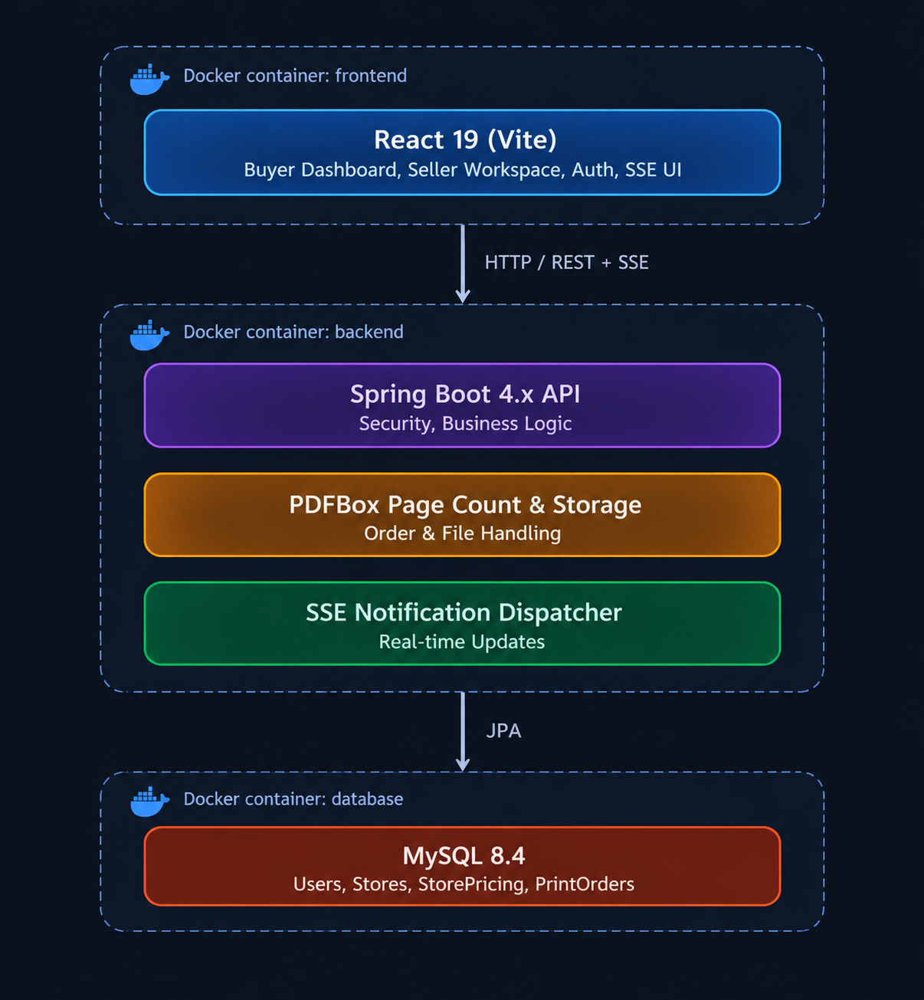

# 🖨️ PrintHub — Online Document Printing & Print Store Management System

**PrintHub** is a modern full-stack web application designed to bridge the gap between document print buyers and local print shop owners. It enables customers to discover nearby print shops, view real-time transparent pricing, upload PDF documents, configure print specifications, and track order fulfillment live. Print shop owners receive a unified seller workspace to manage multiple storefronts, customize print rates, download customer documents, update order progression, and receive instant push updates.

The application combines a **Spring Boot REST API**, a **React 19 frontend with Vite**, and a **MySQL database**. It features session-based authentication with CSRF protection, automated PDF page counting via **Apache PDFBox**, live **Server-Sent Events (SSE)** notification streaming, and full **Docker Compose** containerization.

---

## ✨ Features

### 🔐 Authentication and Role-Based Access Control
- Separate registration and login workflows for **Buyers** and **Sellers**.
- Session-based authentication with secure HTTP-only cookies.
- CSRF protection with custom handshake endpoint (`/api/auth/csrf`).
- Role-based route guarding preventing unauthorized access to seller or buyer workspaces.
- Sleek split-panel login/register interface featuring dynamic branding.



---

### 🏪 Store Management (Seller Workspace)
- Create, view, update, and manage multiple print stores under a single seller account.
- Configure shop contact details: name, street location, email, and phone number.
- Set accurate daily operating hours (opening and closing times).
- Upload and preview custom storefront pictures (JPG/PNG up to 5 MB).
- Store removal safeguard with destructive action confirmation.



---

### 💰 Dynamic Pricing Engine
- Store-specific pricing configuration for print services:
  - **Black & White Single-Sided** cost per page.
  - **Black & White Double-Sided** cost per sheet.
  - **Colour Single-Sided** cost per page.
  - **Colour Double-Sided** cost per sheet.
  - **Document Binding** flat rate per copy.
- Instant price updates reflected across customer order forms in real time.



---

### 🔍 Print Shop Discovery & Details (Buyer Experience)
- Browse active local print shops with a responsive card grid.
- Instant live search by shop name, address, or service description.
- Detailed shop view with contact information, opening hours, and full pricing breakdown.
- Shop card hover overlays with quick-action links.



---

### 📄 PDF Upload & Automatic Page Extraction
- Drag-and-drop PDF file upload supporting documents up to **20 MB**.
- Automated server-side page count extraction using **Apache PDFBox**.
- Configurable printing options:
  - Print Type: Black & White or Full Colour.
  - Print Side: Single-Sided or Double-Sided duplex.
  - Quantity: 1 to 20 copies.
  - Binding: Optional coil/comb binding per copy.
- Instant cost calculation based on extracted page count and store pricing.
- Immediate order confirmation with total pages, sheets per copy, and total price.



---

### 📦 Live Order Lifecycle Tracking
- End-to-end status pipeline:
  - `PLACED` → Order submitted by customer, awaiting seller confirmation.
  - `PRINTING` → Shop has downloaded document and is running the print job.
  - `PRINTED` → Document is ready for pickup at the counter.
  - `COLLECTED` → Customer has collected the completed print job.
  - `CANCELLED` → Order cancelled by customer before printing begins.
- Live order card highlighting when status changes occur.
- Tabbed filters for ongoing, ready for pickup, completed, and all orders.



---

### 📥 Incoming Orders & Job Management (Seller)
- Real-time incoming orders dashboard with summary statistics:
  - Total orders count.
  - New orders awaiting review (`PLACED`).
  - Active printing jobs (`PRINTING`).
  - Orders ready for counter pickup (`PRINTED`).
- Secure one-click original PDF document download.
- Sequential status update buttons (`Start Printing →` / `Mark as Printed →` / `Mark as Collected →`).
- Customer details, timestamp, and complete job specification chips.



---

### 🔔 Real-Time Notification Center (SSE)
- Live server-to-client event streaming using **Server-Sent Events (SSE)**.
- Unread badge counter and animated bell indicator.
- Interactive toast popups with auto-dismiss progress bars.
- Dedicated dropdown panel with notification history, timestamps, and mark-all-read action.
- Automatic reconnection with exponential backoff on network interruptions.



---

### 🎨 GolfSpace-Inspired Athletic UI Design
- High-contrast, sporty dark palette:
  - **Dominant Slate Grey** (`#454952` / `#3C4048`) providing a sleek, modern architectural tone.
  - **High-Voltage Yellow-Green** (`#BAFF39`) accents for punchy primary actions.
  - **Light Grey** (`#E2E5EB`) and **Pure White** (`#FFFFFF`) for crisp readability.
- Custom origami paper plane sticker brand identity.
- Fully responsive across desktop, tablet, and mobile screen sizes.

---

### 🐳 Docker Support
- Multi-container Docker Compose configuration.
- Isolated containers for MySQL database, Spring Boot backend, and Vite React frontend.
- Dedicated Docker volume for MySQL data persistence and local bind mounts for uploaded documents and images.

---

## 🛠️ Tech Stack

| Layer | Technologies |
|---|---|
| **Frontend** | React 19, JavaScript (ES6+), Vite, HTML5, CSS3, Custom Design System |
| **Backend** | Java 25, Spring Boot 4.x |
| **API** | RESTful Web Services |
| **Security** | Spring Security, Role-Based Access Control (RBAC), CSRF Handshake, Session Cookies |
| **Document Processing** | Apache PDFBox (v3.0.6) |
| **Real-Time Updates** | Server-Sent Events (SSE) |
| **Database** | MySQL 8.4 |
| **ORM / Persistence** | Spring Data JPA, Hibernate |
| **Build Tools** | Maven (Backend), npm / Vite (Frontend) |
| **Containerization** | Docker, Docker Compose |
| **Version Control** | Git, GitHub |

---

## 🏗️ Application Architecture

PrintHub follows a decoupled client-server architecture with real-time push streaming.




### How It Works

1. **Authentication**: Users register as either `BUYER` or `SELLER`. The frontend requests a CSRF token from `/api/auth/csrf` and passes it on subsequent state-modifying requests.
2. **Store Setup**: Sellers configure their store details, upload storefront images, and set per-page printing and binding rates.
3. **Browsing & Ordering**: Buyers browse available shops, select their preferred store, and upload their PDF.
4. **Automated Calculation**: The backend processes the uploaded PDF with Apache PDFBox to determine total pages and calculates sheet requirements based on single- or double-sided choices. Total price is calculated dynamically.
5. **Real-Time Notification**: When an order is placed, updated, or cancelled, Spring application events trigger the `OrderNotificationService`, dispatching an SSE event to the respective client's open stream.
6. **Fulfillment**: The seller reviews document specifications, downloads the PDF file, and advances the status (`PLACED` → `PRINTING` → `PRINTED` → `COLLECTED`).

---

## 📁 Project Structure

```text
Printhub/
│
├── printhubback/                      # Spring Boot Backend
│   ├── src/
│   │   ├── main/
│   │   │   ├── java/com/project/printhubback/
│   │   │   │   ├── configuration/     # Security, CORS, WebMvc config
│   │   │   │   ├── controller/        # REST & SSE Controllers
│   │   │   │   ├── dto/               # Auth, Store, and Order DTOs
│   │   │   │   ├── model/             # JPA Entities (User, Store, PrintOrder, Pricing)
│   │   │   │   ├── repository/        # Spring Data JPA Repositories
│   │   │   │   └── service/           # Business logic, PDFBox, Image & SSE services
│   │   │   └── resources/
│   │   │       └── application.properties
│   │   └── test/                      # Unit & Integration Tests
│   ├── pom.xml
│   └── Dockerfile
│
├── printhubfront/                     # React 19 Frontend
│   ├── public/
│   │   ├── favicon.svg                # Paper plane sticker favicon
│   │   └── logo.svg                   # Brand sticker logo
│   ├── src/
│   │   ├── components/
│   │   │   ├── auth/                  # AuthPage (Login & Registration)
│   │   │   ├── buyer/                 # BuyerDashboard, BuyerOrderSection
│   │   │   ├── seller/                # SellerDashboard, SellerOrders
│   │   │   └── notifications/         # NotificationCenter, Toast stack
│   │   ├── App.jsx
│   │   ├── index.css                  # GolfSpace design tokens & global CSS
│   │   └── main.jsx
│   ├── package.json
│   ├── vite.config.js
│   └── Dockerfile
│
├── screenshots/                       # Application preview screenshots
├── docker-compose.yml                 # Multi-container orchestration
└── README.md
```

---

## 🚀 Getting Started

### Prerequisites

Make sure you have the following installed on your machine:

- [Git](https://git-scm.com/)
- [Docker Desktop](https://www.docker.com/products/docker-desktop/)
- [Java JDK 21+](https://adoptium.net/) and [Maven](https://maven.apache.org/) *(if running backend locally outside Docker)*
- [Node.js 20+](https://nodejs.org/) and npm *(if running frontend locally outside Docker)*

---

### 1. Clone the Repository

```bash
git clone https://github.com/afdhalcodes/Printhub_App.git
cd Printhub_App
```

---

### 2. Environment Configuration

Create a `.env` file in the root directory (alongside `docker-compose.yml`):

```env
# MySQL Credentials
MYSQL_ROOT_PASSWORD=your_root_password
MYSQL_DATABASE=printhub
MYSQL_USER=printhub_user
MYSQL_PASSWORD=your_user_password

# Spring Boot Datasource
SPRING_DATASOURCE_URL=jdbc:mysql://db:3306/printhub?useSSL=false&allowPublicKeyRetrieval=true&serverTimezone=UTC
SPRING_DATASOURCE_USERNAME=printhub_user

# Frontend API Target
VITE_API_URL=http://localhost:8080
```

> **Important:** Never commit sensitive passwords or credentials to public source control.

---

### 3. Run with Docker Compose

Build and launch all services (Database, Backend API, and Frontend):

```bash
docker compose up --build
```

To run in detached background mode:

```bash
docker compose up --build -d
```

To view live container logs:

```bash
docker compose logs -f
```

To stop all services:

```bash
docker compose down
```

---

### 4. Running Locally for Development

#### A. Start MySQL Database
Ensure MySQL is running on port `3306` (or `3307` if using Docker for MySQL).

#### B. Run the Backend API
```bash
cd printhubback
mvn spring-boot:run
```
*Backend runs at: `http://localhost:8080`*

#### C. Run the Frontend
```bash
cd printhubfront
npm install
npm run dev
```
*Frontend runs at: `http://localhost:5173`*

---

## 🌐 Application Endpoints Overview

| Endpoint | Method | Role | Description |
|---|---|---|---|
| `/api/auth/csrf` | `GET` | Public | Fetch CSRF security token |
| `/api/auth/register` | `POST` | Public | Register new Buyer or Seller account |
| `/api/auth/login` | `POST` | Public | Authenticate user session |
| `/api/auth/me` | `GET` | Authenticated | Get current authenticated user profile |
| `/api/auth/logout` | `POST` | Authenticated | Terminate session and invalidate cookie |
| `/api/buyer/stores` | `GET` | `BUYER` | List all available print shops |
| `/api/buyer/stores/{id}` | `GET` | `BUYER` | Get shop profile and operating hours |
| `/api/buyer/stores/{id}/pricing` | `GET` | `BUYER` | Get printing rates for a specific shop |
| `/api/buyer/orders` | `POST` | `BUYER` | Upload PDF and place print order |
| `/api/buyer/orders` | `GET` | `BUYER` | View buyer's order history |
| `/api/buyer/orders/{id}/cancel` | `PATCH` | `BUYER` | Cancel order before printing begins |
| `/api/buyer/notifications/stream`| `GET` | `BUYER` | Server-Sent Events stream for buyer |
| `/api/seller/stores` | `GET`, `POST` | `SELLER` | List and create seller print shops |
| `/api/seller/stores/{id}` | `PUT`, `DELETE`| `SELLER` | Update or delete a print shop |
| `/api/seller/stores/{id}/pricing`| `GET`, `POST`, `PUT` | `SELLER` | Configure store print pricing |
| `/api/seller/stores/{id}/picture`| `POST`, `GET` | `SELLER` | Upload and retrieve storefront image |
| `/api/seller/orders` | `GET` | `SELLER` | List all incoming orders for seller's shops |
| `/api/seller/orders/{id}/status` | `PATCH` | `SELLER` | Update order progression status |
| `/api/seller/orders/{id}/document`| `GET` | `SELLER` | Download original customer PDF document |
| `/api/seller/notifications/stream`| `GET` | `SELLER` | Server-Sent Events stream for seller |

---

## 🔒 Security & Privacy Considerations

- **Session Security**: Session cookies are maintained with proper samesite and security policies.
- **CSRF Token Handshake**: State-changing endpoints require valid `X-XSRF-TOKEN` headers.
- **Role Isolation**: Strict Spring Security filter chain ensures Buyers cannot manipulate store data and Sellers cannot place orders as customers.
- **Document Protection**: PDF downloads and store images are validated for MIME type, size limits (20 MB for documents, 5 MB for pictures), and ownership.
- **Isolated File Storage**: Documents are stored outside public web roots with dedicated access control services.

---

## 🎯 Learning Outcomes

This project demonstrates practical full-stack engineering expertise in:

- Designing robust RESTful services and enterprise web architecture with **Spring Boot 4.x**.
- Implementing session security, role-based authorization, and CSRF protection with **Spring Security**.
- Real-time client-server communication using **Server-Sent Events (SSE)**.
- Document parsing, validation, and metadata extraction with **Apache PDFBox**.
- Building high-performance, modular React 19 user interfaces with **Vite** and custom CSS design systems.
- Crafting modern, high-contrast sports/athletic aesthetics inspired by real-world platforms like **GolfSpace**.
- Relational schema modeling, foreign key constraints, and cascading rules with **MySQL** and **Hibernate JPA**.
- Full-stack containerization and multi-service deployment with **Docker Compose**.

---

## 🔮 Future Improvements

- [ ] Online payment gateway integration (Stripe / Razorpay).
- [ ] Multi-file batch document uploads (ZIP, Word docx conversion to PDF).
- [ ] In-browser PDF preview canvas for proofing before print.
- [ ] Automated SMS / WhatsApp pickup alerts when order is `PRINTED`.
- [ ] Map view with geolocation to find the nearest open print shop.
- [ ] Seller analytics dashboard for monthly revenue and print volume.

---

## 👨‍💻 Author

**Afdhal Mohamed A**

- GitHub: [@afdhalcodes](https://github.com/afdhalcodes)
- Project Repository: [Printhub_App](https://github.com/afdhalcodes/Printhub_App)

---

*PrintHub is a full-stack document printing and store management platform built to explore enterprise web architectures, real-time push streaming, automated document processing, and containerized deployment.*
